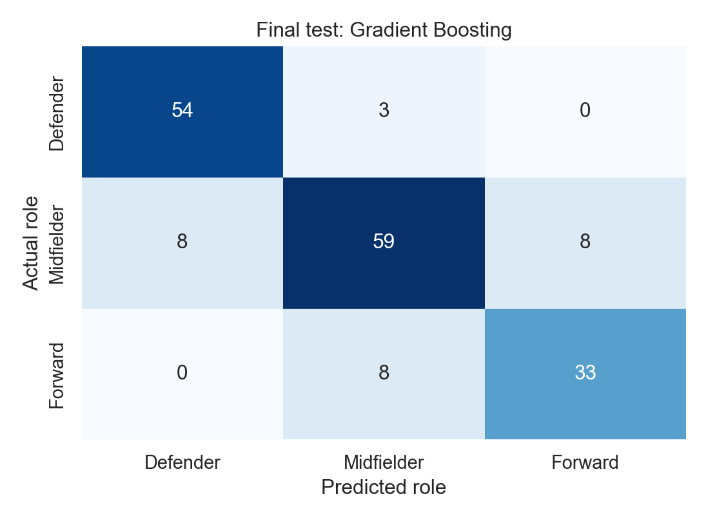

# Football Player Role Classification

Classifying Argentinian outfield players as defenders, midfielders, or forwards using FIFA 22 physical attributes and skill ratings. The notebook compares four classifiers, tunes their parameters with five-fold cross-validation, and evaluates the selected model on a reserved test set.

**Selected model:** Gradient Boosting, learning rate 0.05, 200 boosting stages.

**Final test accuracy:** 84.39% on 173 held-out players.

[View the notebook](week4_football_models.ipynb)

## Dataset

[FIFA 22 complete player dataset](https://www.kaggle.com/datasets/stefanoleone992/fifa-22-complete-player-dataset), published by Stefano Leone from SoFIFA Career Mode data. The included extract contains 960 Argentina players from one edition. Excluding goalkeepers leaves **864 distinct outfield players**: 285 defenders, 372 midfielders, and 207 forwards.

The target groups each player's first listed position into a broad role. Inputs are age, height, weight, preferred foot, pace, shooting, passing, dribbling, defending, and physical rating. Names, IDs, position strings, overall ratings, and position-specific ratings are excluded from the predictors.

The dataset is included under its **CC0: Public Domain** license. [Source and extraction details](data/README.md).

## Evaluation

- Stratified 80/20 split with `random_state=42`: 691 training players and 173 test players.
- Identical shuffled, stratified five-fold CV splits for every comparison.
- Imputation and encoding fitted inside each fold; KNN also uses `StandardScaler`.
- KNN and tree-depth sweeps, followed by Random Forest and Gradient Boosting grid searches.
- Model selection uses training-only CV accuracy. The selected classifier predicts the final test set once.

### Tuned cross-validation results

| Model | Mean accuracy | Standard deviation |
| --- | ---: | ---: |
| KNN, K = 7 | 83.22% | 3.72 percentage points |
| Decision Tree, depth = 10 | 78.59% | 3.32 percentage points |
| Random Forest, 100 trees, unrestricted depth | 83.65% | 3.64 percentage points |
| Gradient Boosting, rate = 0.05, 200 stages | 85.25% | 3.68 percentage points |

The Random Forest grid contains nine combinations, evaluated over five folds: **45 CV fits**, plus one best-model refit. Gradient Boosting uses another nine-combination grid. Tuning left the forest's baseline mean unchanged and made little difference to boosting's baseline mean.

The notebook's overfitting table compares training scores with held-out **CV fold** scores. The separate 20% test set remains unused until the final step. The Decision Tree has the largest train–CV gap; KNN has the smallest.

### Final held-out result

Gradient Boosting achieved **84.39% accuracy** and **0.8421 macro F1**. Forward precision and recall were both **80.49%**. The model was selected before these test results were calculated.



## Run locally

Use Python 3.11 or newer. From the project folder:

```powershell
python -m venv venv
.\venv\Scripts\python.exe -m pip install -r requirements.txt
.\venv\Scripts\python.exe -m notebook week4_football_models.ipynb
```

On macOS or Linux, use `venv/bin/python` instead of `.\venv\Scripts\python.exe`. In Jupyter, choose **Kernel > Restart Kernel and Run All Cells**. The dataset is local; no Kaggle credentials, GPU, or additional download is needed.

## Files

- `week4_football_models.ipynb`: executed analysis and model comparisons
- `data/argentina_players_22.csv`: the included FIFA 22 extract
- `data/README.md`: source, scope, and target definitions
- `outputs/`: CV tables, tuning curves, grid-search results, and final predictions
- `requirements.txt`: required packages

## Scope

These results describe one historical video-game dataset, not live match performance or real scouting suitability. Multi-position players are reduced to their first listed role, and the Argentina-only sample limits generalization. Small CV differences should be read alongside fold variation.
